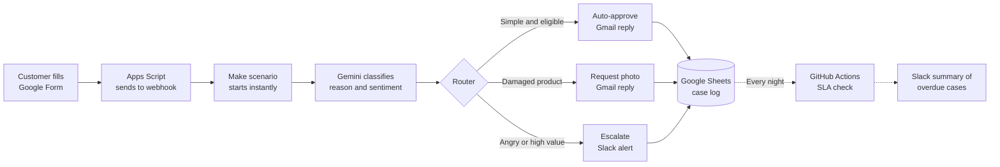

# Beauty Returns Triage Agent

An AI-powered workflow that reads customer return and complaint requests for a beauty e-commerce shop, decides what to do with each one, and acts on it automatically.

## The problem

A support agent reads every return request by hand, checks the order, decides whether to approve it, and writes a reply. It is slow, repetitive, and easy to miss urgent cases.

## How it works



1. A customer submits a return request through a Google Form.
2. A Google Apps Script sends the answer to a Make webhook, so the scenario starts instantly.
3. Make looks up the order and sends the message to Gemini.
4. Gemini returns structured JSON with the return reason, customer sentiment and a short summary.
5. A router sends the case to one of three branches based on the rules below.
6. Every case is logged in Google Sheets with its status.
7. A nightly GitHub Actions job finds cases waiting longer than 48 hours and posts a summary to Slack.

## Decision rules

| Condition | Action |
|---|---|
| Customer is angry, or order value is above €150 | Escalate to the team in Slack |
| Product arrived damaged | Ask the customer for a photo |
| Wrong item or changed mind, within 14 days of delivery | Auto-approve and send return instructions |
| Anything else | Escalate to the team in Slack |

The router filters do not overlap, so each case takes exactly one path. Escalation is the fallback route.

## Tech stack

| Area | Tools |
|---|---|
| Workflow orchestration | Make |
| AI classification | Google Gemini API |
| Intake form | Google Forms, Google Apps Script |
| Data store | Google Sheets |
| Notifications | Gmail, Slack API |
| Scheduled jobs and CI | GitHub Actions |
| Scripts | TypeScript, Node.js |
| Testing | Vitest |

## Project structure

```
make/          Exported Make scenario blueprints (JSON)
apps-script/   Script that sends form answers to the Make webhook
src/           TypeScript scripts, such as the nightly SLA check
tests/         Unit tests for the decision and SLA logic
sample-data/   Mock orders and example customer requests
templates/     Slack and email message templates
docs/          Screenshots and process diagrams
.github/       GitHub Actions workflows
```

## Setup

See [docs/setup.md](docs/setup.md) for step-by-step instructions.

## Author

**Shadi Shirinbeikmohajer** · [LinkedIn](https://www.linkedin.com/in/shadishirinbeik/)
